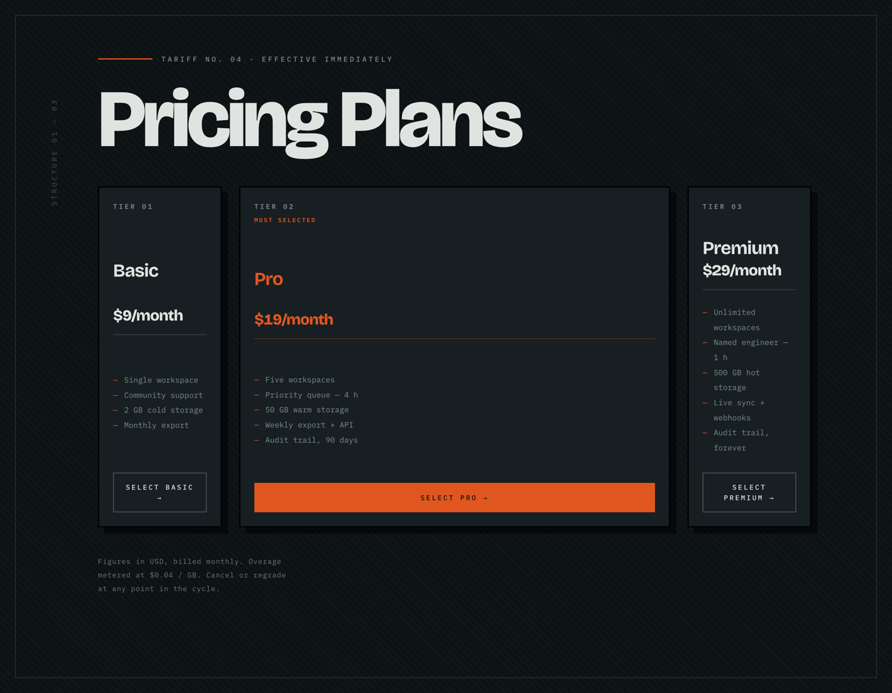

# Pricing Plans — "Tariff No. 04"

A three-tier pricing layout built for the freeCodeCamp lab **Design a Pricing Plans Layout Page**. The lab fixes the mechanics (flexbox ordering and sizing); everything else is art direction. Here the page is treated as an **engineering tariff sheet**: a dark instrument panel, hard black card borders, mono data labels and a single ember-orange signal colour.

> **Primary goal of this project:** practise **frontend design** inside a fixed lab spec. The tests only check that the flexbox rules exist — the point of the exercise is deciding what the page *means* and how it should look and feel.

<p align="center">
  
</p>

*Desktop layout at 1440 px: Basic (200 px) → Pro (696 px) → Premium (200 px). Pro takes the remaining space via `flex-grow: 2`.*

---

## Contents

- [Purpose](#purpose)
- [Screenshots](#screenshots)
- [The task](#the-task)
- [How it is implemented](#how-it-is-implemented)
- [Design layer](#design-layer)
- [Layout decisions worth knowing](#layout-decisions-worth-knowing)
- [Project structure](#project-structure)
- [Getting started](#getting-started)
- [Verification](#verification)

## Purpose

The page is a static HTML/CSS artefact with no build step. It exists to:

1. Satisfy every user story and automated test of the freeCodeCamp pricing-layout lab.
2. Serve as a design exercise — a deliberately non-generic visual identity rather than the default "SaaS pricing grid".
3. Demonstrate practical flexbox behaviour: a wrapping container, fixed-basis cards that must stay uniform, and reordering without touching the DOM order.

## Screenshots

| File | What it shows |
| --- | --- |
| [`screenshots/pricing-plans-desktop.png`](screenshots/pricing-plans-desktop.png) | Full desktop layout, 1440 × 1120 — three cards in one row with the accent Pro plan centred and stretched |
| [`screenshots/pricing-plans-mobile.png`](screenshots/pricing-plans-mobile.png) | Narrow layout at 390 px — the container wraps and all three cards stack full-width (342 px) in DOM-independent `order` |
| [`screenshots/pro-plan-hover.png`](screenshots/pro-plan-hover.png) | Hover state: the Pro card shifts into its hard offset shadow while an orange signal bar wipes across the card's bottom edge |

## The task

The lab spec lives in `AGENTS.md`: 14 user stories and 27 automated assertions. Condensed:

| # | Requirement |
| --- | --- |
| 1–4 | An `h1` reading **Pricing Plans**, immediately followed by a `div.pricing-container` |
| 5–7 | `.pricing-container` must use `display: flex` and `flex-wrap: wrap` |
| 8–12 | Three `div.pricing-card` children, one each additionally carrying `.basic-plan`, `.pro-plan`, `.premium-plan` |
| 13–17 | Every card: `display: flex`, `flex-direction: column`, `justify-content: space-between`, `flex: 0 0 200px`, `border: 2px solid black` |
| 18–23 | Display order driven by `order` — basic `0`, pro `1`, premium `2` — with `.pro-plan` also using `flex-grow: 2` |
| 24–27 | Exact copy: `Basic`/`$9/month`, `Pro`/`$19/month`, `Premium`/`$29/month`; premium must be last in the layout |

Under the hood the lab is about four flexbox ideas: the **flex container**, **wrapping**, the **`flex` shorthand** (grow/shrink/basis), and **`order`** for visual reordering.

## How it is implemented

Everything is hand-written HTML and CSS — no frameworks, no JavaScript, no build tooling.

**Structure (`index.html`)**

```
main.shell
└─ span.rail            (rotated marginalia, decorative, aria-hidden)
└─ header.masthead
   ├─ p.eyebrow         "Tariff No. 04 · Effective immediately"
   ├─ h1                Pricing Plans
   ├─ div.pricing-container
   │  ├─ div.pricing-card.basic-plan      span.tier → h2 → p → ul.ledger → a.select
   │  ├─ div.pricing-card.pro-plan        (same)
   │  └─ div.pricing-card.premium-plan    (same)
   └─ p.colophon        (footnote)
```

Each card is laid out with `display: flex; flex-direction: column; justify-content: space-between`, which pushes the tier label to the top and the call-to-action to the bottom edge — so cards of different text length still end flush.

**Key CSS (`styles.css`)**

```css
.pricing-container {
  display: flex;
  flex-wrap: wrap;
  gap: clamp(1rem, 2.2vw, 1.75rem);
}

.pricing-card {
  display: flex;
  flex-direction: column;
  justify-content: space-between;
  flex: 0 0 200px;        /* fixed 200px basis, no grow, no shrink */
  min-width: 0;           /* defeats min-content inflation (see below) */
  border: 2px solid black;
}

.basic-plan   { order: 0; }
.pro-plan     { order: 1; flex-grow: 2; }   /* declared after .pricing-card */
.premium-plan { order: 2; }
```

Three details keep the lab's assertions and the intended layout in agreement:

1. **`.pro-plan` is declared *after* `.pricing-card`.** Both are single-class selectors with equal specificity, so source order decides. Putting `flex-grow: 2` after the `flex: 0 0 200px` shorthand overrides just the grow factor while the computed shorthand stays reportable as `0 0 200px`.
2. **`min-width: 0` on every card.** A flex item's automatic minimum size is its min-content width, so an unbreakable word such as "Premium" or "$29/month" would otherwise stretch a card past 200 px. Zeroing it keeps all three cards exactly 200 px; `overflow-wrap: anywhere` is the belt-and-braces fallback so no string ever overflows the border.
3. **Narrow screens widen cards with `min-width: 100%`, not `flex-basis`.** If the mobile breakpoint changed the basis, the computed shorthand would become `0 0 100%` and an assertion checking `flex: 0 0 200px` would fail whenever the grader ran in a narrow viewport. Using `min-width` gets the responsive behaviour while the declared shorthand is untouched.

## Design layer

**Art direction** — an industrial tariff/specification sheet rather than a marketing grid: tier numbers, storage figures in the feature list, and a small-print colophon about overage metering.

**Colours — five tokens only** (no gradients, no purple/violet, no neon, no neutral-beige palette):

| Token | Value | Used for |
| --- | --- | --- |
| `--ink` | `#0d1214` | Page ground |
| `--panel` | `#171f22` | Card surface |
| `--chalk` | `#dfe4e0` | Primary type |
| `--muted` | `#7c8b8a` | Labels and ledger text |
| `--signal` | `#e0561f` | The single accent: eyebrow rule, ledger dashes, Pro prices, hover bar |

Black appears only as the spec-required `2px` card border. The backdrop is a fine 45° drafting hairline hatch plus a thin printed-sheet frame — deliberately not a checkerboard grid.

**Typography — two families:** [Bricolage Grotesque](https://fonts.google.com/specimen/Bricolage+Grotesque) for display (headline, plan names, prices) and [IBM Plex Mono](https://fonts.google.com/specimen/IBM+Plex+Mono) for data (eyebrow, tier labels, feature ledger, buttons). No Inter or Roboto.

**Decoration without extra markup** — the hatch, the page frame, the vertical rail text and the growing hover bar are all `::before`/`::after` pseudo-elements, so the document stays at four `div`s total (container + three cards). That keeps tests such as "the `div` below the `h1`" unambiguous.

**Motion** — staggered entrance keyframes per card, a hover interaction where the card shifts by 4 px into its hard offset shadow while the orange bar widens from 0 to 100%, and `prefers-reduced-motion: reduce` disables all of it.

## Layout decisions worth knowing

| Decision | Why |
| --- | --- |
| Graded text nodes contain plain text only (`<h2>Basic</h2>`, `<p>$9/month</p>`) | Assertions compare `textContent`/`innerText`; nested spans would change the string |
| `.pricing-container` is the `h1`'s immediate next sibling | Story 2 asks for the container "below the `h1`"; nothing sits between them |
| Only four `div`s exist in the document | A "first `div`" selector cannot accidentally match a wrapper |
| Display type is sized so the longest string (127 px) fits the 151 px content box | Guarantees single-line prices and headings inside the fixed 200 px width at every breakpoint |

## Project structure

```
pricing-layout/
├── index.html
├── styles.css
├── package.json          # metadata only — no dependencies
├── AGENTS.md             # lab spec shipped by freeCodeCamp
├── README.md
└── screenshots/
    ├── pricing-plans-desktop.png
    ├── pricing-plans-mobile.png
    └── pro-plan-hover.png
```

## Getting started

No build step and no dependencies — plain HTML and CSS.

**Option 1:** open `index.html` in a browser.

**Option 2:** serve it locally (e.g. the VS Code *Live Server* extension, or Python):

```bash
python3 -m http.server 8000
# then visit http://localhost:8000
```

Webfonts load from Google Fonts, so offline rendering falls back to Helvetica Neue; self-host the two families if you need offline fidelity.

## Verification

Checked in Chrome with a 25-check computed-style suite covering every one of the lab's 27 assertions — **all pass**:

- Card widths at 1440 px: **200 / 696 / 200** px, all three 551 px tall, one row.
- Computed values confirmed: `display: flex`, `flex-wrap: wrap`, `flex-direction: column`, `justify-content: space-between`, `flex: 0 0 200px`, `border: 2px solid black`, `order` `0/1/2`, `.pro-plan` `flex-grow: 2`.
- Responsive: no horizontal overflow at 1440, 1024, 500 or 390 px; at 390 px the cards stack full-width in three rows.
- Contrast: headline 14.65:1, body and labels ≥ 4.7:1, orange price 4.06:1 (passes WCAG AA for large text).

## License

Educational project completed as part of the freeCodeCamp curriculum.
